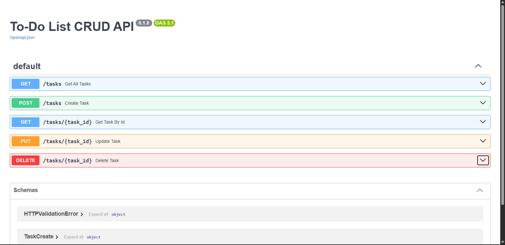

# 🚀 FastAPI To-Do CRUD API

A clean, production-grade RESTful API built with Python and FastAPI, implementing full CRUD (Create, Read, Update, Delete) operations with in-memory state management and automatic OpenAPI documentation.

---

## 🛠️ Tech Stack & Tools

- **Language:** Python 3.10+
- **Framework:** FastAPI
- **Server:** Uvicorn (ASGI)
- **Validation:** Pydantic V2
- **Environment & Package Management:** `uv`
- **Documentation:** Built-in Swagger UI (`/docs`)

---

## 📋 Endpoint Reference Table

| Operation         | HTTP Method | Endpoint Path | Description                                        |
| :---------------- | :---------- | :------------ | :------------------------------------------------- |
| **Create**        | `POST`      | `/tasks`      | Add a new task with input validation               |
| **Read (All)**    | `GET`       | `/tasks`      | Retrieve the complete list of tasks                |
| **Read (Single)** | `GET`       | `/tasks/{id}` | Fetch a specific task by its unique ID             |
| **Update**        | `PUT`       | `/tasks/{id}` | Replace/update an existing task's title and status |
| **Delete**        | `DELETE`    | `/tasks/{id}` | Remove a task from memory by its ID                |

---

## ⚙️ Local Setup & Run Instructions

Get this API running locally in under a minute using `uv`:

1. **Clone the repository:**

   ```bash
   git clone https://github.com/YOUR-USERNAME/todo-crud-api.git
   cd todo-crud-api
   ```

2. **Initialize environment and install dependencies with `uv`:**

   ```bash
   uv venv
   uv pip install fastapi uvicorn
   ```

3. **Start the development server:**

   ```bash
   uv run uvicorn main:app --reload
   ```

4. **Access the Application:**
   - **API Root:** [http://localhost:8000](http://localhost:8000)
   - **Interactive Swagger UI:** [http://localhost:8000/docs](http://localhost:8000/docs)

---

## 🔍 Example `curl -i` Output

Testing `GET /tasks` with header inclusion enabled:

```http
HTTP/1.1 200 OK
date: Mon, 02 Nov 2026 15:06:08 GMT
server: uvicorn
content-length: 102
content-type: application/json

[{"id":1,"title":"Buy groceries","completed":false},{"id":2,"title":"Study FastAPI","completed":true}]
```

---

## 📸 Swagger UI Screenshot

__
